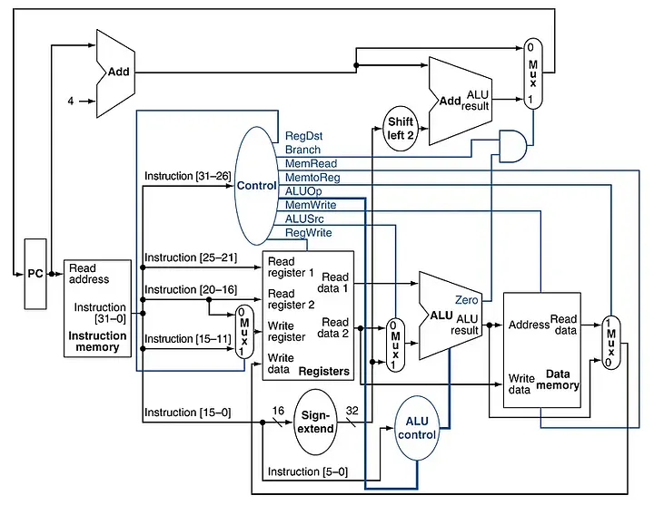

# A Single-Cycle RISC-V Processor
- Designed by Steven Kuzhipala during EECS 31L-Winter 2026, under Professor Elmalaki. 
- Designed using AMD Vivado™ Design Suite. 
- This processor was built in seperate stages, from the operation modules for the ALU Control Unit, the Register, Data and Instruction Memory Units, and ultimately wiring all the modules together. 
- Each individual module has been tested with their own test bench, along with a final testbench with basic arthemetic operations carried out by the processor. 

## Processor Datapath
<!--

-->

## Repo Structure
- Each branch includes the verilog files for each module, along with a Lab report for the design descisions behind each module. 
- Each lab report also includes the testing bench simulation waveforms included for each module, along with a short analysis for each waveform. 

##Piplined Version
- Currently working creating a pipelined version of the processor, to be synthesized and ported onto a Xilinx Artix-7 FPGA. Find Repo [here](https://github.com/bobbybendola/Pipelined_RISC-V)

### Short Note
This design process, necessary intuition, and elaborate lectures in this class pushed me to pursue my interest in Computer Architecture and building systems from the ground up : ). 
